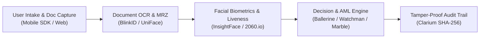

# Awesome Know Your Customer (KYC) & Identity Orchestrator 🛡️

  <strong>Curated directory of enterprise SaaS platforms, open-source KYC tools, facial liveness biometrics, and AML identity orchestrator engines.</strong>

     

---

## 📌 Table of Contents

- [🌐 Sector Overview & Market Dynamics](#-sector-overview--market-dynamics)
- [🏢 SaaS & Hosted KYC Platforms](#-saas--hosted-kyc-platforms)
- [💻 Open-Source GitHub Projects](#-open-source-github-projects)
  - [Top KYC & AML Orchestrators & Engines](#top-kyc--aml-orchestrators--engines)
  - [Specialized Modules & Utilities](#specialized-modules--utilities)
  - [Developer Frameworks & Blueprints](#developer-frameworks--blueprints)
- [🤝 How to Contribute](#-how-to-contribute)
- [💖 Support](#-support)
- [📊 Star History](#-star-history)
- [⚖️ Disclaimer & Compliance Guide](#️-disclaimer--compliance-guide)

---

## 🌐 Sector Overview & Market Dynamics

The global **Identity Verification (IDV) and KYC market** is valued at approximately **$15.78 billion to $16.89 billion in 2026** and is projected to expand beyond **$33 billion by 2031**, registering a compound annual growth rate (CAGR) of 13.5% to 15%. 

The sector is **moderately concentrated** at the top tier—dominated by well-capitalized enterprise identity giants like Trulioo, Alloy, Persona, Jumio, and Onfido/Entrust that capture massive enterprise spend—while maintaining a **highly fragmented long-tail** of regional and niche innovators driven by localized regulatory jurisdictions (e.g., EU AMLA/eIDAS, US FinCEN, India Aadhaar e-KYC), vertical-specific fraud patterns, and emerging crypto compliance requirements.

---

## 🏢 SaaS & Hosted KYC Platforms

Below is a comparative breakdown of the leading commercial KYC identity orchestration vendors, ranked by **company scale (valuation / annual revenue)** in descending order:

| Provider | Scale (Valuation / Revenue) 📈 | Starting Price (USD) 💳 | Free Tier / Trial Limit ⏱️ | Key Capabilities & Highlights 🔍 |
| :--- | :--- | :--- | :--- | :--- |
| **[Trulioo](https://www.trulioo.com/)** | $1.75B Valuation / ~$100M ARR | Starting at $99/mo base tier | Contact for custom pilot / Sandbox testing access available | Global identity verification platform providing identity network checks, document authentication, and KYB business verification covering 195+ countries. |
| **[Alloy](https://www.alloy.com/)** | $1.55B Valuation | Starting at $500/mo base orchestration commitment | Sandbox trial environment upon sales qualification | Premier identity risk decisioning platform providing multi-provider waterfall routing, transaction monitoring, and automated KYC/KYB fraud workflows. |
| **[Persona](https://withpersona.com/)** | $1.50B Valuation / ~$75M ARR | Starting at $250/mo minimum commitment | 30-day sandbox trial; Startup Program grants 500 free verifications/mo for 1st year | Flexible no-code identity platform supporting automated document checks across 200+ countries, liveness verification, dynamic risk signals, and graph investigation. |
| **[Jumio](https://www.jumio.com/)** | ~$1.20B Enterprise Valuation / $150M+ ARR | Blended rates starting at $0.90/verification | Sandbox testing account available upon demo request | AI-driven ID verification engine and comprehensive AML screening platform with over 1 billion historical identity verifications processed globally. |
| **[Middesk](https://www.middesk.com/)** | $760M Valuation | $2.50/verification + $19/business registration check | Sandbox environment with $50 test credits for developers | Dedicated business verification (KYB) and compliance infrastructure providing automated Secretary of State filings, registered agent data, and beneficial ownership mapping. |
| **[Onfido](https://onfido.com/)** | $650M Valuation (Acquired by Entrust) | Starting at $1.20/verification | 30-day developer sandbox trial upon enterprise consultation | Trusted global IDV provider with hybrid AI and human expert document review, biometric selfie/video liveness, and financial-grade anti-spoofing. |
| **[Sumsub](https://sumsub.com/)** | $500M+ Valuation / ~$70M ARR | Starting at $1.35/verification ($149/mo minimum) | 14-day free trial with introductory live sandbox verification tests | All-in-one compliance suite featuring modular KYC, KYB, continuous AML watchlist screening, and real-time fraud transaction monitoring. |
| **[Veriff](https://www.veriff.com/)** | $400M Valuation / ~$50M ARR | Starting at $0.80/verification ($49/mo minimum) | 15-day free trial with up to 50 complimentary identity verification sessions | Fully automated AI biometric identity verification platform with real-time video-based fraud detection, document analysis, and assisted manual review options. |
| **[IDnow](https://www.idnow.io/)** | €300M+ Valuation | Starting at €1.15/verification (€150/mo minimum) | Structured PoC sandbox period upon compliance team review | Pan-European identity verification suite offering eIDAS-compliant automated document checks, remote video-identification (VideoIdent), and e-signatures. |
| **[Passbase](https://passbase.com/)** | $30M Valuation (Acquired by Parallel Markets) | Starting at $0.99/verification ($99/mo base) | 14-day free trial with 50 live verification credits | Developer-centric digital identity verification API providing frictionless cross-platform SDKs, biometric liveness challenges, and reusable identity credentials. |

---

## 💻 Open-Source GitHub Projects

Explore open-source identity verification engines, biometric face recognition toolkits, and AML screening software. Star badges link directly to the stargazers of each respective repository.

### Top KYC & AML Orchestrators & Engines

* **[face_recognition](https://github.com/ageitgey/face_recognition)**   
  The world's simplest and most popular facial recognition library for Python and the command line. Built on top of `dlib` with deep learning models, making it a foundational engine for face matching in custom KYC pipelines.

* **[insightface](https://github.com/deepinsight/insightface)**   
  State-of-the-art 2D and 3D deep face analysis toolbox powered by PyTorch and ONNX Runtime. Extensively deployed in high-throughput identity verification pipelines for facial recognition, attribute analysis, and anti-spoofing.

* **[deepface](https://github.com/serengil/deepface)**   
  A lightweight facial recognition and facial attribute analysis framework for Python. Wraps top-performing models (VGG-Face, Google FaceNet, OpenFace, ArcFace) into a unified identity verification API.

* **[Ballerine](https://github.com/ballerine-io/ballerine)**   
  **The leading open-source infrastructure for identity and risk orchestration** (Y Combinator-backed). Features ready-to-use KYC/KYB onboarding UI flows, case management dashboards, multi-vendor identity verification plugins, and a flexible rule decisioning engine.

* **[uniface](https://github.com/yakhyo/uniface)**   
  All-in-one lightweight face analysis library built on ONNX Runtime. Features face detection (RetinaFace, SCRFD), recognition (ArcFace, AdaFace), anti-spoofing (MiniFASNet), gaze estimation, and vector store integration for KYC matching.

* **[opensanctions](https://github.com/opensanctions/opensanctions)**   
  Open-source international sanctions, politically exposed persons (PEP), and corporate registry database crawler. An indispensable tool for open-source AML and financial crime compliance screening.

* **[marble](https://github.com/checkmarble/marble)**   
  Real-time risk decisioning engine designed for fintech compliance, automated KYC routing, fraud transaction monitoring, and rules evaluation.

* **[watchman](https://github.com/moov-io/watchman)**   
  Open-source financial regulatory compliance engine by Moov. Automatically downloads, indexes, and queries global OFAC, BIS, and EU sanctions lists via a fast, containerized Go service.

* **[blinkid-android](https://github.com/microblink/blinkid-android)**   
  Production-grade mobile SDK for scanning and extracting machine-readable data (MRZ) from passports, IDs, and driver's licenses for mobile KYC onboarding.

* **[Face-Liveness-Detection-SDK-Linux](https://github.com/FaceOnLive/Face-Liveness-Detection-SDK-Linux)**   
  Accurate face anti-spoofing server SDK for Linux providing multi-modal liveness checks against print, screen replay, and mask spoofing attacks.

* **[ID-DocumentRecognition-Linux](https://github.com/MiniAiLive/ID-DocumentRecognition-Linux)**   
  Server OCR engine for ID cards, passports, and driver's licenses, specialized for on-premise document data extraction in self-hosted KYC setups.

* **[iOS-FaceRecognition-FaceLivenessDetection](https://github.com/recognito-vision/iOS-FaceRecognition-FaceLivenessDetection)**   
  High-accuracy NIST FRVT-evaluated face recognition and liveness detection SDK tailored for native iOS identity verification applications.

* **[IDCardRecognition-Docker](https://github.com/kby-ai/IDCardRecognition-Docker)**   
  Containerized ID card, passport, and driving permit OCR recognition engine for microservice-based identity capture pipelines.

* **[org.id](https://github.com/windingtree/org.id)**   
  Self-Sovereign Identity (SSI) solution and W3C-DID compliant decentralized business verification (KYB) protocol for organizations.

* **[authsome](https://github.com/xraph/authsome)**   
  Extensible Go identity engine with plugins for enterprise verification sessions, KYC webhook handling, and middleware access controls.

* **[vision-liveness-detector](https://github.com/2060-io/vision-liveness-detector)**   
  Gesture-based facial liveness detector by 2060.io utilizing randomized physical challenges (blinking, smiling, turning head) to eliminate replay attacks.

* **[Clarium](https://github.com/QuantSingularity/Clarium)**   
  RegTech compliance module with FastAPI KYC/AML engine featuring hash-chained SHA-256 tamper-detectable audit trails and multi-jurisdiction rules.

* **[open-kyc](https://github.com/College-Canine/open-kyc)**   
  TypeScript community project enabling free KYC compliance workflows and document handling.

* **[tf-kyc-verifier](https://github.com/threefoldtech/tf-kyc-verifier)**   
  Go-based KYC verification service for ThreeFold with webhook processing and automated identity token issuance.

---

### Specialized Modules & Utilities

* **[django-camera-kit](https://pypi.org/project/django-camera-kit/)** — Live document edge detection, corner adjustment, and selfie liveness capture widgets for Django and pgvector.
* **[personal_validation_system](https://pub.dev/packages/personal_validation_system)** — Mobile KYC verification and document validation plugin for Flutter.
* **[FaceVault](https://docs.hollaex.com/plugins/use-plugins/facevault-automatic-kyc)** — Automated hosted KYC verification plugin tailored for crypto exchanges.
* **[pykolofinance](https://pypi.org/project/pykolofinance/)** — Banking microservice integration with Dojah for Nigerian BVN, NIN, and biometric verification.
* **[crypto-aml](https://pypi.org/project/crypto-aml/)** — Crypto wallet risk screening and transaction monitoring SDK with graph visualization.
* **[passive_liveness](https://pub.dev/packages/passive_liveness)** — Flutter passive liveness detection library using MiniFASNet.

---

### Developer Frameworks & Blueprints

> **Architecture Tip**: For a complete self-hosted, enterprise-grade identity stack, combine **Ballerine** for user onboarding & orchestration, **insightface** or **UniFace** for facial matching, **moov-io/watchman** for automated sanctions screening, and **Clarium** for immutable audit trail generation.

---

## 🤝 How to Contribute

Contributions are welcome! Help us keep this list comprehensive and up-to-date:

1. 🍴 **Fork** this repository.
2. 🌿 **Create a branch** for your updates (`git checkout -b feature/add-new-kyc-tool`).
3. 📝 **Add or edit entries** in `README.md` keeping formatting consistent (include name, scale/stars, pricing, and key features).
4. 🚀 **Submit a Pull Request** with a brief summary of the project.

---

## 💖 Support

If you find this curated collection valuable for your projects or research:

- ⭐ **Star** this repository to show your appreciation!
- 🍴 **Fork** and share it with your fellow engineers, fintech developers, and compliance teams.
- ☕ **Support the author**: Consider sponsoring or buying a coffee via the [GitHub Sponsors Dashboard](https://github.com/sponsors/ishandutta2007).

---

## 📊 Star History

---

## ⚖️ Disclaimer & Compliance Guide

- This directory is **community-curated** for educational, technical, and informational purposes. It does not constitute legal, regulatory, or compliance advice.
- KYC identity verification systems handling biometric and document data must strictly comply with **GDPR, CCPA, BIPA, AMLD5/6, and regional privacy frameworks**. Always involve certified compliance and legal teams.
- **Model Licensing Notice**: While orchestration frameworks are often MIT or Apache 2.0 licensed, specific underlying computer vision models (such as YOLOv5-Face weights or FairFace datasets) carry GPL-3.0 or non-commercial CC BY 4.0 licenses. Ensure licensing audits before commercial release.
- **Biometric Security**: Biometric embeddings cannot be reset like passwords. Always implement strong end-to-end encryption, on-device processing when possible, and tamper-evident audit logs.

---

  Built with ❤️ for fintech engineers, compliance teams, and builders of privacy-preserving identity systems.

